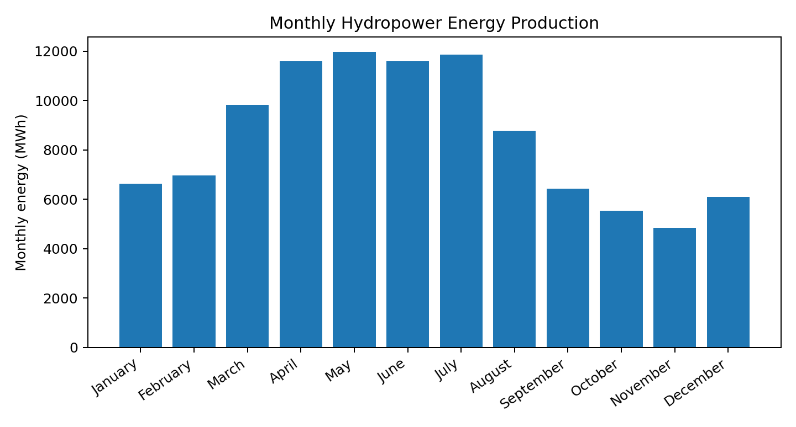
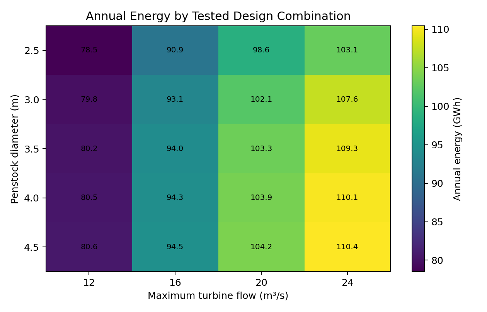

# Hydropower Generation and Performance Analysis Using Python

**Author:** Duran Ali Toklu  
**Field:** Energy Systems Engineering  
**Environment:** Python / Google Colab  
**Libraries:** NumPy, Pandas, Matplotlib

## Project overview
This project is an educational Python simulation of hydropower generation. It evaluates how inflow, ecological flow release, turbine flow capacity, penstock friction and minor losses affect net head and energy production.

> **Data integrity note:** All flow values and system parameters are illustrative assumptions. They are not measured operating data from Kavşak Bendi HEPP or any other real plant.

## Repository structure
```text
hydropower-generation-analysis/
├── README.md
├── requirements.txt
├── .gitignore
├── src/
│   └── hydropower_analysis.py
├── notebooks/
│   └── Hydropower_Generation_Analysis.ipynb
├── data/
│   └── assumed_monthly_flows.csv
├── results/
│   ├── monthly_energy_results.csv
│   ├── design_sweep_results.csv
│   └── top_10_designs.csv
├── figures/
│   ├── monthly_energy.png
│   └── design_sweep_heatmap.png
└── docs/
    ├── en/
    │   ├── Hydropower_Technical_Report_EN.pdf
    │   └── Hydropower_Technical_Report_EN.docx
    └── tr/
        ├── Hydropower_Technical_Report_TR.pdf
        └── Hydropower_Technical_Report_TR.docx
```

## Baseline assumptions
- Gross head: 100 m
- Overall efficiency: 85%
- Ecological flow release: 10% of incoming flow
- Maximum turbine flow: 20 m³/s
- Penstock length / diameter: 1,000 m / 3.0 m
- Darcy friction factor: 0.02
- Minor-loss coefficient: 2.0
- Monthly inflow (January–December): 12, 14, 18, 25, 30, 28, 22, 16, 12, 10, 9, 11 m³/s

## Baseline results
- Annual energy: **102,055.61 MWh (102.056 GWh)**
- Annual average power: **11.650 MW**
- Time-weighted average head loss: **1.991 m**
- Time-weighted average net head: **98.009 m**



## Design parameter sweep
The tested design grid covers penstock diameters from 2.5 to 4.5 m and maximum turbine flows from 12 to 24 m³/s. The highest simulated energy in this limited grid is **110.426 GWh/year**, at a diameter of 4.5 m and a maximum turbine flow of 24 m³/s. This is an energy-only result, not a techno-economic optimum.



## Run locally
```bash
pip install -r requirements.txt
python src/hydropower_analysis.py
```
The notebook can also be opened in Google Colab.

## HydroGenerate status
The HydroGenerate package was installed and its `calculate_hp_potential` interface was inspected during development. A numerical comparison is **pending independent verification**; no HydroGenerate numerical result is claimed as validated.

## Limitations
1. Monthly flow values are assumed, not measured.
2. Overall efficiency and hydraulic coefficients are constant.
3. Hydraulic losses use a simplified Darcy–Weisbach model and one minor-loss coefficient.
4. Turbine efficiency maps, part-load behaviour, water hammer, cavitation, outages, sediment and detailed environmental constraints are not modelled.
5. The design sweep tests a limited set of discrete combinations.
6. Economic optimization is not included.

## References
- Idaho National Laboratory, [HydroGenerate documentation](https://idaholabresearch.github.io/HydroGenerate/)
- [HydroGenerate on PyPI](https://pypi.org/project/HydroGenerate/)
